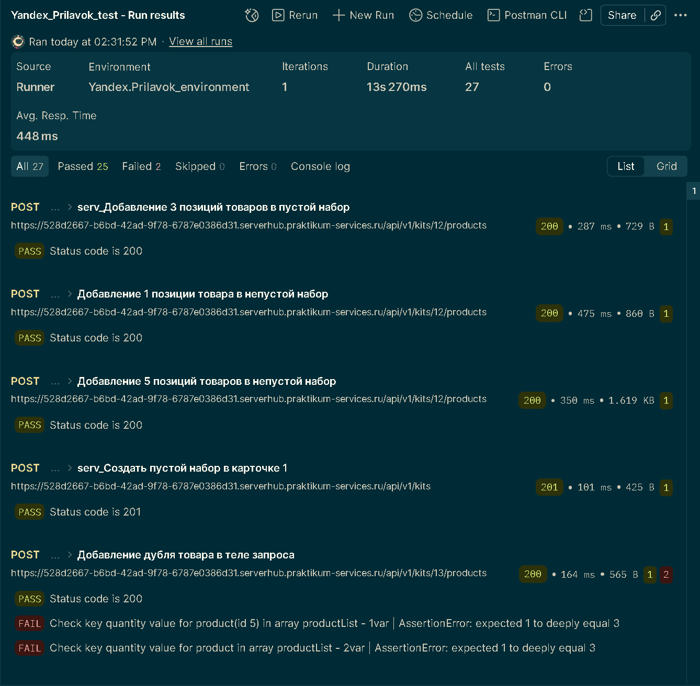
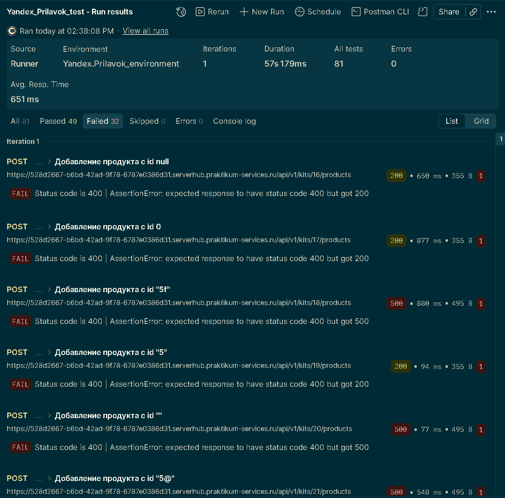

# Postman API Testing Project — Яндекс.Прилавок (v3.1.1)

Автономная коллекция автоматизированных API-тестов в **Postman** для сервиса покупок и доставки **Яндекс.Прилавок (v3.1.1)**, покрывающая интеграционное взаимодействие REST JSON и XML-эндпоинтов, ролевую модель доступа и валидацию типов данных.

Коллекция спроектирована на основе полного тест-комплекта из **202 атомарных проверок** и сопровождается **36 задокументированными баг-репортами**.

## Связанная тестовая документация

* [Чек-лист API (202 проверки) и баг-репорты (36 дефектов) в Google Sheets](https://docs.google.com/spreadsheets/d/1DBqjCwPRBV2OShBDvjJS1uIe7LDJOKYIpPDlnzfm1vs/edit?gid=1667785858#gid=1667785858)

## Архитектура и особенности коллекции

1. **Полная автономность и Chaining запросов:**
   * Коллекция не зависит от заранее созданных данных в БД — все необходимые сервисные сущности (пользователи, авторизационные токены, пользовательские наборы, корзины) создаются динамически в процессе выполнения.
   * Извлечение идентификаторов и токенов из ответов реализовано через скрипты (`Tests` / `Post-response`) с сохранением в переменные коллекции (`pm.collectionVariables`) и передачей в последующие запросы цепочки.

2. **Динамическая генерация тестовых данных:**
   * Для обеспечения уникальности сущностей при многократных прогонах применяются встроенные генераторы Postman (`{{$randomFirstName}}`, `{{$randomInt}}` и др.) и изоляция переменных на уровне коллекции.

3. **Разделение конфигурации окружения и данных:**
   * Базовый адрес стенда вынесен в переменную окружения `server_url` (`Yandex.Prilavok_environment.postman_environment.json`), что позволяет переключаться между стендами без правки запросов.

4. **Автоматизированные проверки (Assertions):**
   * Запросы снабжены JS-проверками на базе `pm.test` и `pm.expect`: верификация HTTP-статус-кодов, структуры JSON/XML-ответов, граничных значений и бизнес-ограничений (например, лимит на 30 позиций в наборе).

## Область тестирования (Scope)

* **Управление пользовательскими наборами (`POST /api/v1/kits/{id}/products`):** позитивные сценарии (граничные значения 1–30 позиций), дублирование товаров, проверка прав доступа (BOLA / IDOR — разграничение прав между авторизованными и неавторизованными пользователями), стресс-тестирование типов данных (`null`, `boolean`, массивы, объекты, выход за пределы `int`).
* **Управление корзиной (`PUT /api/v1/orders/{id}`, `DELETE /api/v1/orders/{id}`):** добавление и суммирование позиций, проверка ролевой модели при работе с чужими корзинами, валидация типов `id` и `quantity`, удаление корзин.
* **Расчёт логистики и доставки (`POST /fast-delivery/v3.1.1/calculate-delivery.xml`):** проверка XML-схем запросов и ответов, граничные значения времени доставки, веса и количества товаров, обработка пустых и отсутствующих XML-тегов.

## Состав репозитория

* `Yandex_Prilavok_test.postman_collection.json` — экспортированная коллекция Postman (v2.1) со скриптами и автопроверками.
* `Yandex.Prilavok_environment.postman_environment.json` — файл окружения с переменной `server_url`.
* `README.md` — описание проекта и инструкция по запуску.

## Инструкция по запуску

> **Примечание о тестовом стенде:** API Яндекс.Прилавок разворачивается в изолированной песочнице с динамическим URL. В экспортированном файле окружения значение `server_url` оставлено пустым по соображениям безопасности.

### Запуск через Postman Desktop / Web
1. Скачайте файлы коллекции (`.postman_collection.json`) и окружения (`.postman_environment.json`) из репозитория.
2. В Postman нажмите **Import** и загрузите оба файла.
3. Выберите окружение **Yandex.Prilavok_environment** в правом верхнем углу, откройте его настройки и укажите актуальный URL стенда в поле **Current value** переменной `server_url`.
4. Нажмите на три точки (`...`) рядом с коллекцией → **Run collection** → **Run**.

### Запуск через CLI (Newman)
```bash
newman run Yandex_Prilavok_test.postman_collection.json \
  -e Yandex.Prilavok_environment.postman_environment.json \
  --env-var "server_url=https://<your-sandbox-stand-url>"
```
## 📊 Пример прогона в Postman Collection Runner

### Позитивные сценарии (`POST /api/v1/kits/{id}/products`)


* **Результат прогона:** `25 Passed / 2 Failed` (все запросы выполнены без сетевых ошибок, цепочки создания наборов `serv_Создать пустой набор...` и добавления позиций отрабатывают корректно).
* **Локализованный дефект (Б1):** падение проверок в запросе *«Добавление дубля товара в тело запроса»* подтверждает баг бизнес-логики — при передаче одного и того же товара двумя объектами в массиве `productsList` бэкенд учитывает только количество из первого объекта (`expected 1 to deeply equal 3`).

### Негативные сценарии и валидация типов данных (`POST /api/v1/kits/{id}/products`, вкладка `Failed`)


* **Результат прогона:** `49 Passed / 32 Failed`.
* **Локализованные дефекты (Б2-Б11):** на скриншоте зафиксированы два класса критических дефектов валидации поля `id` (ожидался ответ `400 Bad Request`):
  * **Б2 (`200 OK` вместо `400`):** сервер принимает невалидные значения (`null`, `0`, строковое число `"5"`) и добавляет некорректный объект в набор.
  * **Б3 (`500 Internal Server Error` вместо `400`):** сервер падает с необработанным исключением при передаче нечисловых строк и спецсимволов (`"5f"`, `""`, `"5@"`).
